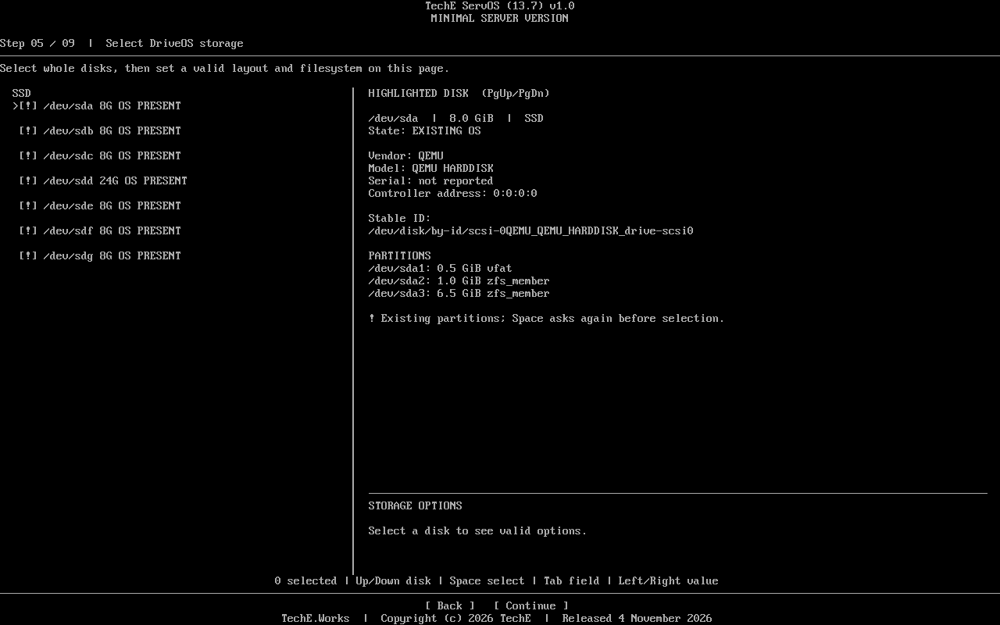
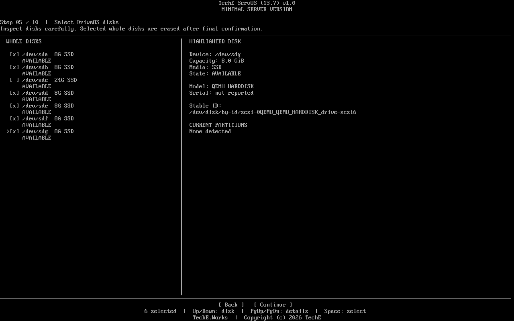
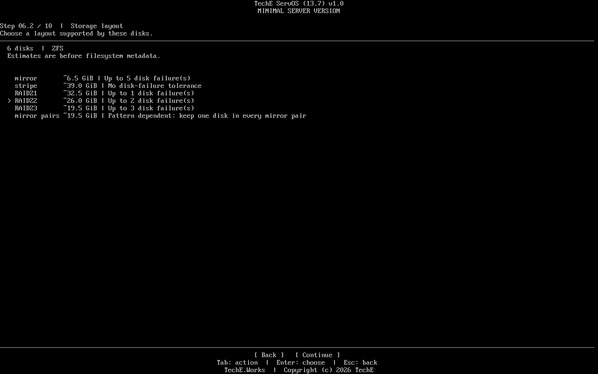

# TechE ServOS (13.7) v1.0 — release 1.0.0

Released 2026.11.05 by TechE.Works. Contact:
[sysadmin@teche.works](mailto:sysadmin@teche.works) ·
[teche.works](https://teche.works).

ServOS installs a minimal Debian 13.7 server from a compact network ISO.
It installs the selected DriveOS storage, kernel and bootloader, networking,
OpenSSH, sudo and APT. It does not install a desktop, Docker, NetBird or
WorkDesk. Selected storage packages are downloaded only for the chosen layout.
The installed system is standalone and does not depend on Proxmox.

**Why use it:** select one disk or a supported redundant layout in the same
text installer, inspect disk identity before the typed erase confirmation, and
boot into a small SSH-ready base. The installer downloads the packages needed
for the selected layout; applications can be added later. See three
[real QA captures](#installer-captures) below.

## Downloads and integrity

Download from the [versioned GitHub Release](https://github.com/TechEWorks/release/releases/tag/servosv1.0-v1.0.0).
Verify each file against [SHA256SUMS.txt](https://github.com/TechEWorks/release/releases/download/servosv1.0-v1.0.0/SHA256SUMS.txt)
before use. The release assets are:

| Asset | Purpose | Bytes | SHA-256 |
| --- | --- | ---: | --- |
| [TechE-ServOS-13.7-v1.0-amd64-network.iso](https://github.com/TechEWorks/release/releases/download/servosv1.0-v1.0.0/TechE-ServOS-13.7-v1.0-amd64-network.iso) | Bootable network installer | 71,696,384 | `b449436c0575a0dd95d61a3a228b0cbe465f415b64dea392352b1da2c04556cf` |
| [BUILD-INPUT-Pinned-Base-ISO.iso](https://github.com/TechEWorks/release/releases/download/servosv1.0-v1.0.0/BUILD-INPUT-Pinned-Base-ISO.iso) | Pinned build input; do not install this image | 63,307,776 | `7a473b485c3a81406098e2806a6a489b88eb10e44da188db86b92e7a37dfa55a` |
| [TechE-ServOS-13.7-v1.0-SOURCE.zip](https://github.com/TechEWorks/release/releases/download/servosv1.0-v1.0.0/TechE-ServOS-13.7-v1.0-SOURCE.zip) | Buildable source, tests and license | 115,286 | `f63ce9c9dde59ff4e8f5b9260a589f32bfaec224de72f66ee0900001cd526013` |
| [RELEASE-MANIFEST.json](https://github.com/TechEWorks/release/releases/download/servosv1.0-v1.0.0/RELEASE-MANIFEST.json) | Machine-readable provenance and asset record | See checksums | See checksums |

The ISO was built from private product source commit
`359909def220ac8b152d4015cecd28f959770ddf`, Git tree
`f805c77e945ec6ad0331edda074f3dd08b4b3c9e`. The CI run used the
same tree through pull-request merge commit
`3aabc441a3da27267cbb5980e91839b51e55f0c3`. See the
[build guide](BUILD.md) and the [byte-identical public rebuild](QA.md#verified-checks)
for independent verification.

## What the installer offers

- **Storage:** one disk with ext4, XFS, Btrfs or ZFS; multiple disks with
  supported ZFS, mdadm or Btrfs layouts. The available layouts change with
  the number of selected disks. The choice and expected usable capacity are
  shown before erasure.
- **Network:** DHCP by default, or manually entered static IPv4, gateway and
  DNS. Internet access is required during installation.
- **Access:** a non-root administrator with a password or OpenSSH public key.
  Root SSH login is disabled.
- **Review:** disk model, serial, stable ID, partitions, layout, network and
  access summary followed by typed `ERASE` confirmation.
- **After boot:** the same system summary appears on console and interactive
  SSH, including kernel, CPU, network, DriveOS capacity and storage, GPU when
  present, and package commands.

## Guides and release record

1. [Install and first boot](INSTALL.md)
2. [Full feature and setup path](FEATURES.md)
3. [Download source and build the ISO](BUILD.md)
4. [Exact QA coverage and post-release checks](QA.md)
5. [License, upstream notices and IP](LEGAL.md) · [dated LICENSE.txt](LICENSE.txt)
   · [upstream attribution](NOTICE.md)
6. [Changes in this release](CHANGELOG.md)
7. [Network ISO output record](outputs/network-iso/ReadMeFirst.txt)

## Installer captures

These are unaltered VM225 captures from preceding installer candidates.
They show interface behavior with generic QEMU disks, including disk inspection
and six-disk ZFS layout selection. They are not
exact-byte screenshots or acceptance evidence for the published ISO. The
published ISO's single-disk ext4, XFS and ZFS, ZFS mirror, mdadm RAID1/XFS, and
Btrfs RAID1 live tests, plus the static IPv4 and SSH-key path and open checks,
are recorded in
[QA](QA.md).

| Capture | What it shows |
| --- | --- |
| [Disk inspection](screenshots/01-disk-inspection.png) | Existing OS and partition details before choosing a target |
| [Six-disk selection](screenshots/02-six-disk-selection.png) | Whole-disk choice and stable-ID inspection |
| [ZFS layouts](screenshots/03-zfs-layout-choices.png) | Eligible layouts, estimated usable capacity and failure tolerance |

**Scope:** x86-64 UEFI, Secure Boot off, wired IPv4 and a reachable Debian
package mirror. The ISO is network based, not an offline package repository.
The known unverified paths are identified in [QA](QA.md); publication does not
turn those checks into passes.
