# ServOS capabilities — full-width screen gallery

Seventeen original, unaltered screen captures show the installer workflow across the ServOS v1.0 line. Choose a category below. [Capture identities and file hashes](capture-manifest.tsv) provide the technical provenance in one place.

- [Disk safety](#disk-safety)
- [Storage](#storage)
- [Progress](#progress)

## Disk safety

### Inspect disk identity

Model, stable ID and existing partitions before target selection.

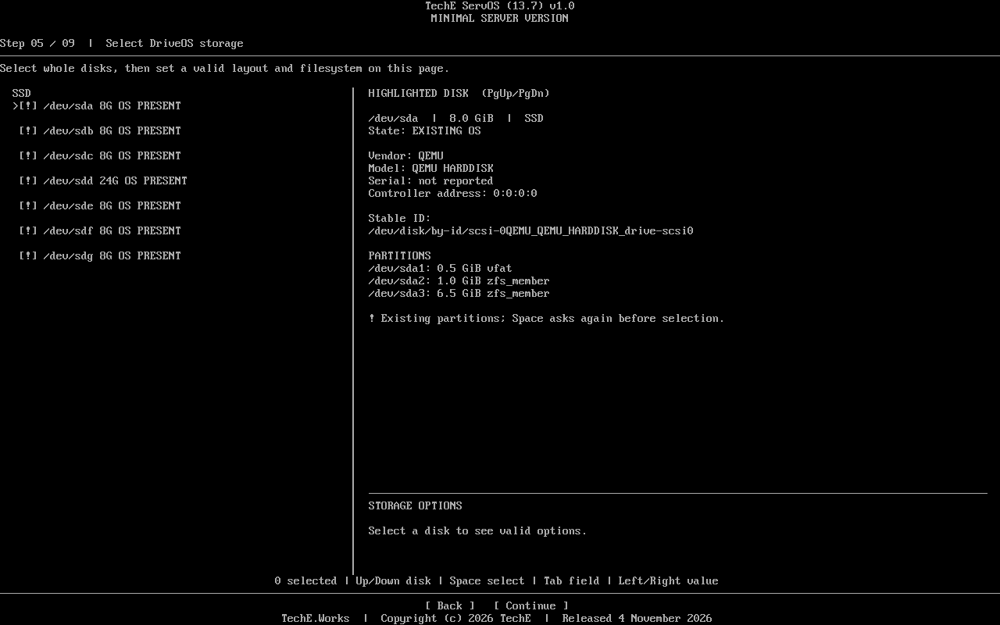

### Choose multiple drives

Two selected disks remain identifiable while the ZFS mirror layout is chosen.

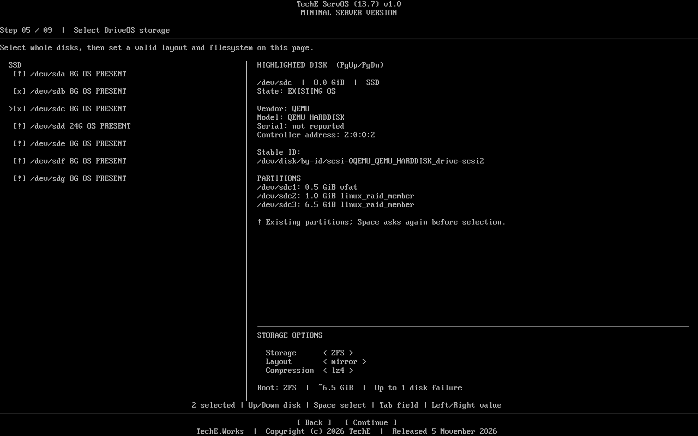

### Review ext4 settings

The selected disk and installation choices appear together.

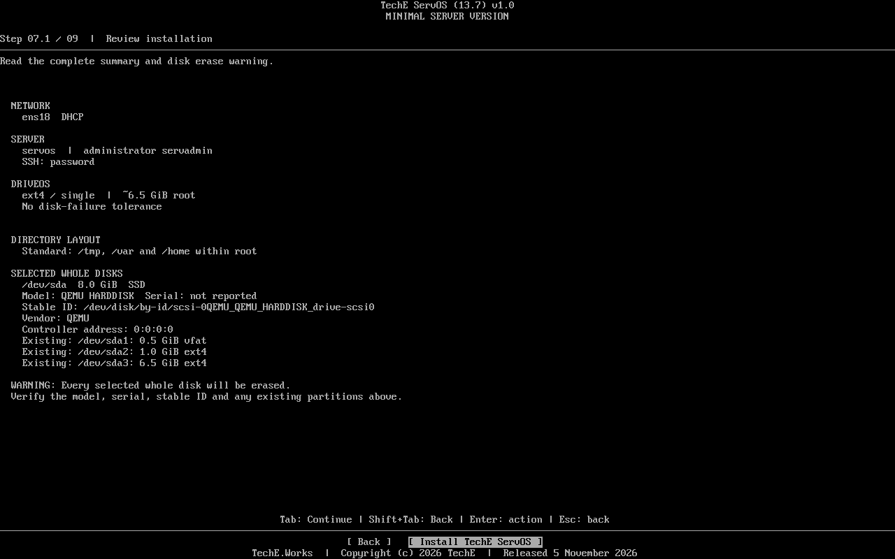

### Typed erase gate

The operator confirms the destructive step by typing ERASE.

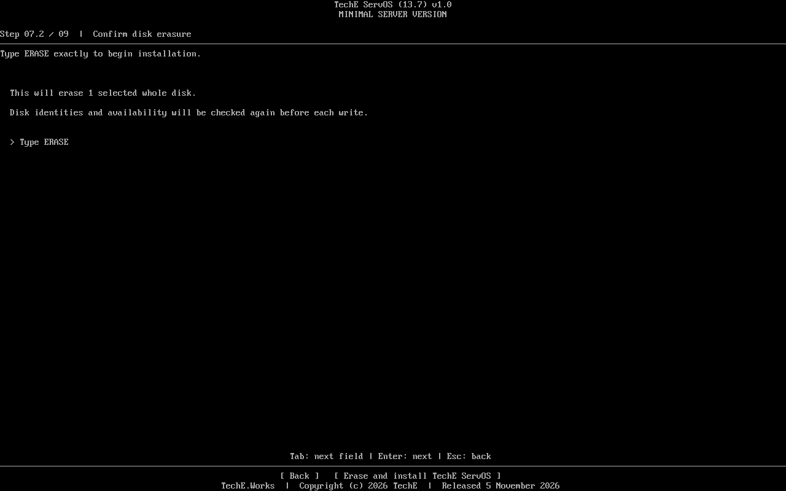

### Select the target disk

The whole disk is identified before storage is chosen.

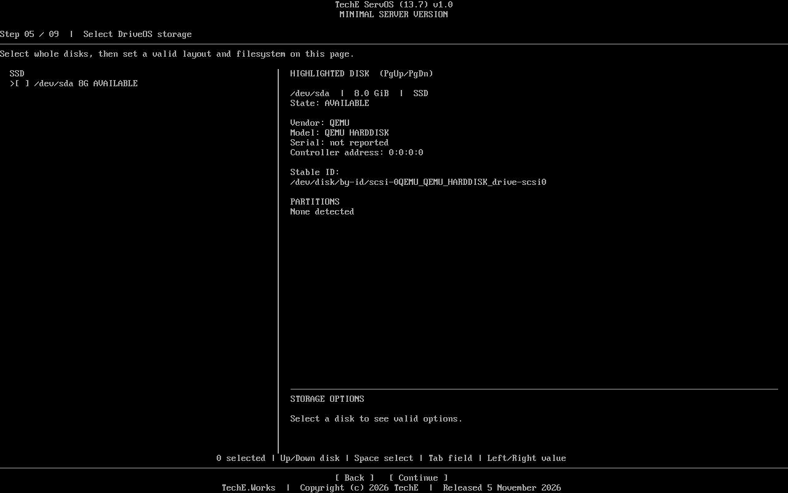

### Review the installation

Storage, network and access choices are visible before erasure.

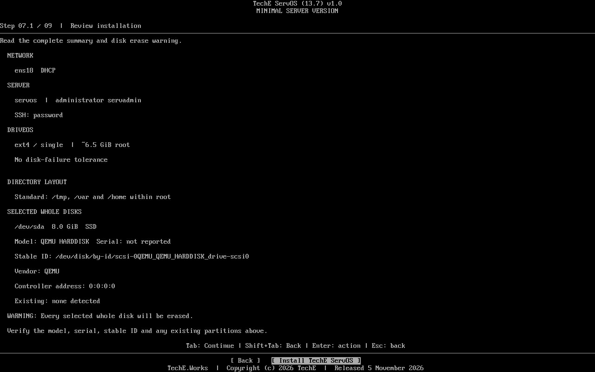

### Confirm ERASE

Typed confirmation separates review from disk writing.

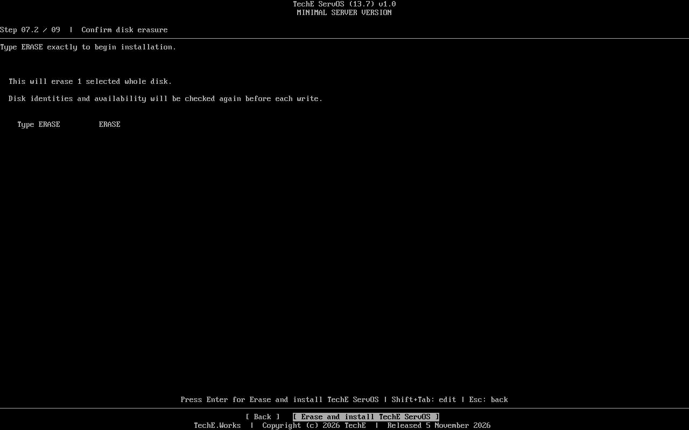

## Storage

### Compare ZFS layouts

The three-disk RAIDZ1 menu shows estimated root capacity and one-disk tolerance; this is a layout choice.

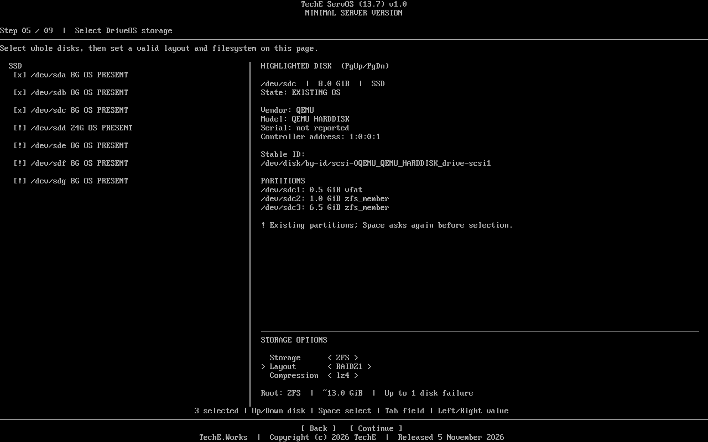

### ZFS mirror review

Both selected members and the mirror choice appear before writing.

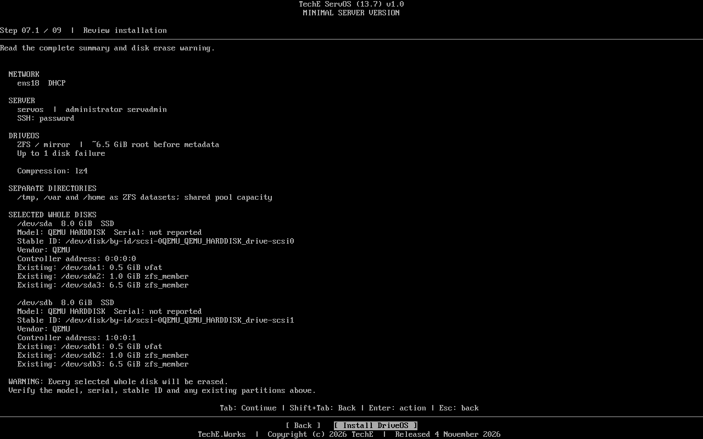

### Choose mdadm storage

The installer presents an mdadm array path.

### Choose ext4

The storage page shows the single-disk ext4 path.

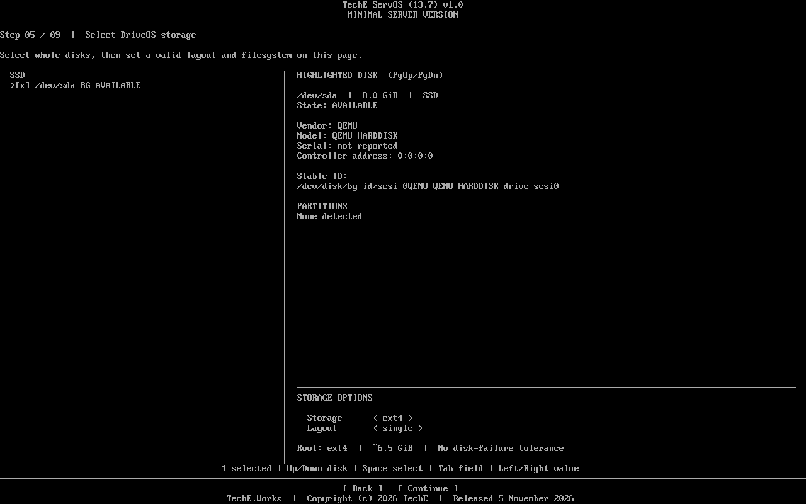

## Progress

### Six tasks complete

Numbered installation tasks reach the completion state.

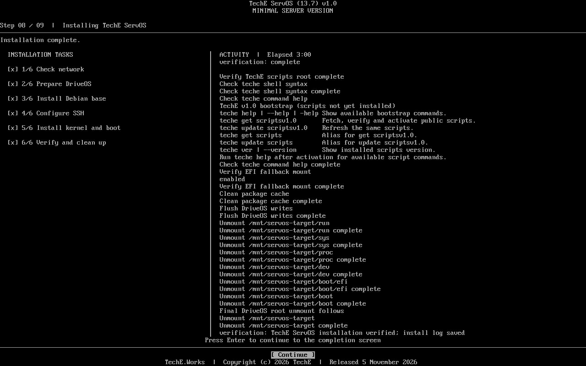

### Btrfs RAID1 install complete

A multi-disk installation reaches the completion screen.

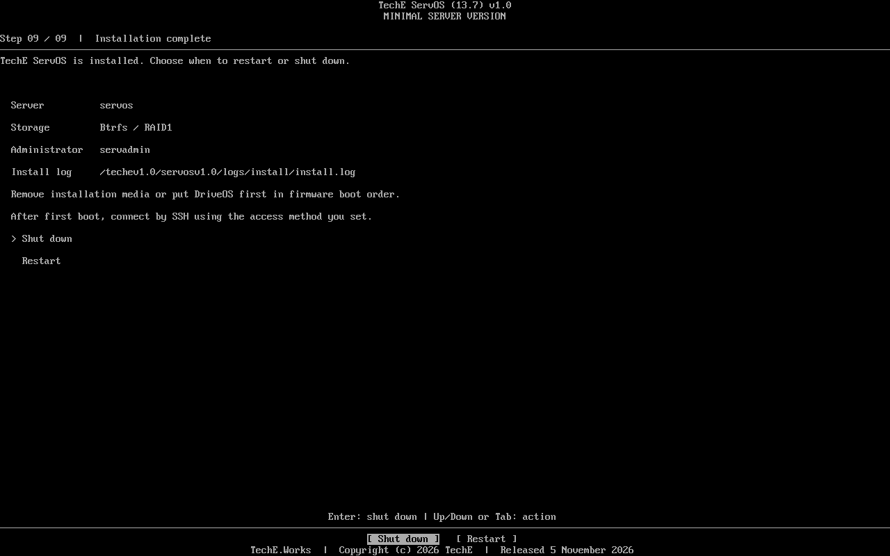

### XFS install complete

The XFS installation finishes its numbered tasks.

### Watch live work

Numbered tasks and the activity pane show installation in progress.

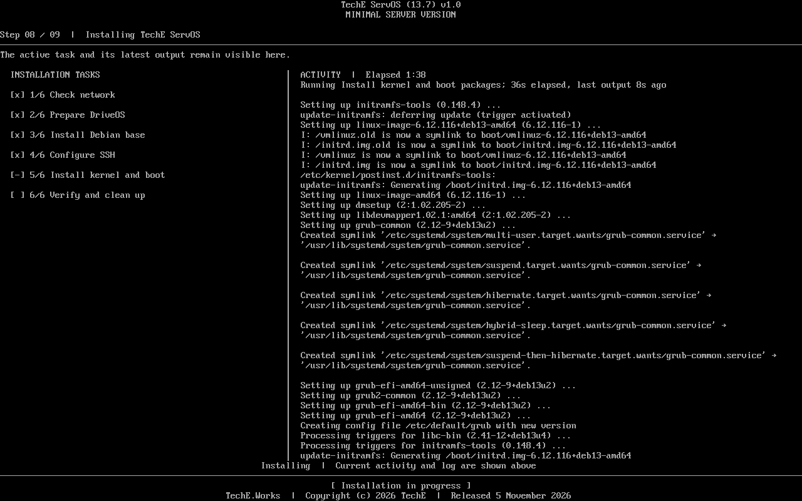

### Complete six tasks

The progress screen shows completion of all six tasks.

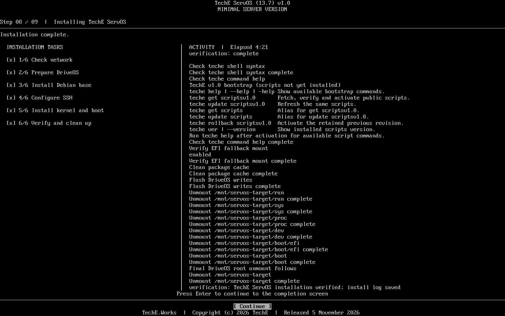

### Finish and boot

The completion screen gives the log path and next boot action.

