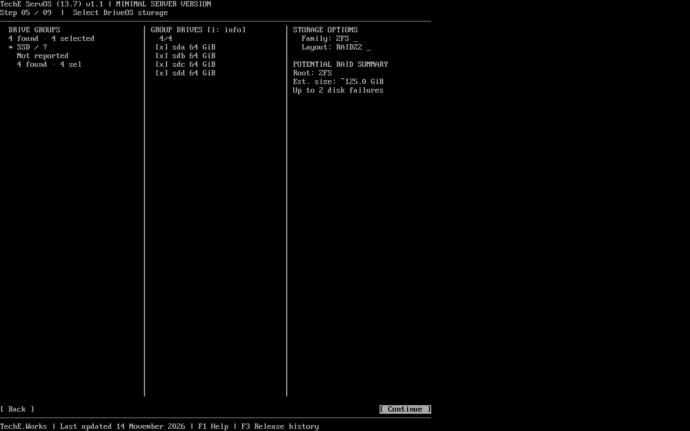
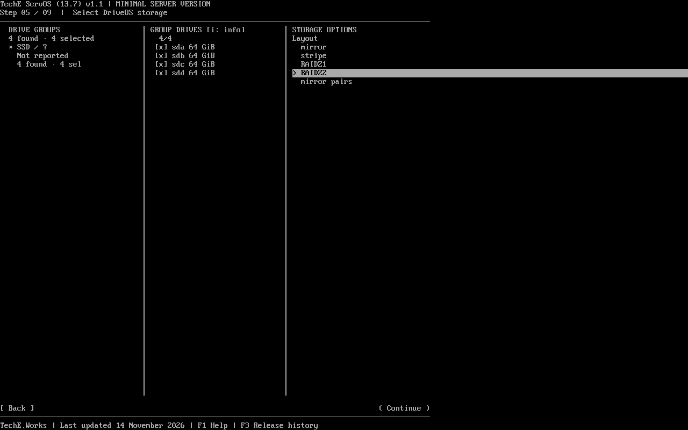

# TechE ServOS 1.1.0

A compact network installer for a minimal Debian 13 server. Choose the target disks, review the storage layout and install an SSH-ready system from a local console or remote management console.

[Download v1.1.0](https://github.com/TechEWorks/release/releases/tag/servosv1.0-v1.1.0) · [Release manifest](RELEASE-MANIFEST.json) · [QA and known limits](QA.md) · [22 installer screenshots](screenshots/README.md)

## ZFS RAIDZ2 on four disks

The three-column DriveOS screen groups drives, displays disk selection and exposes compatible storage layouts. The RAID summary estimates root capacity and disk-failure tolerance before installation.

The same storage flow offers mdadm and Btrfs where eligible. Press **i** for disk details, **F1** for keyboard help and **F3** for release history. The [gallery](screenshots/README.md) shows the full BIOS and UEFI installation flow from the release candidate.

## Installation

Use blank target disks or make a verified backup first. The installer needs a reachable Debian package mirror and erases selected disks after typed confirmation. The live SSH session in this build accepts unauthenticated connections on the selected IPv4 interface, so use an isolated installation network. The installed server uses the credentials you configure during setup.

The [v1.0.0 release](../1.0.0/README.md) remains available for previous deployments. Restore backups before reinstalling an earlier version.
