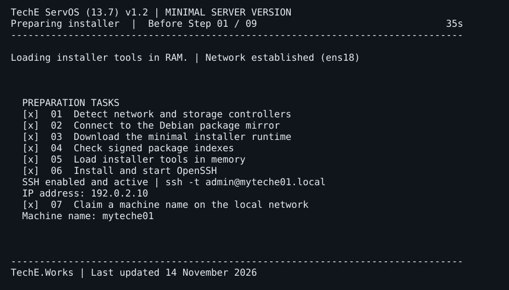
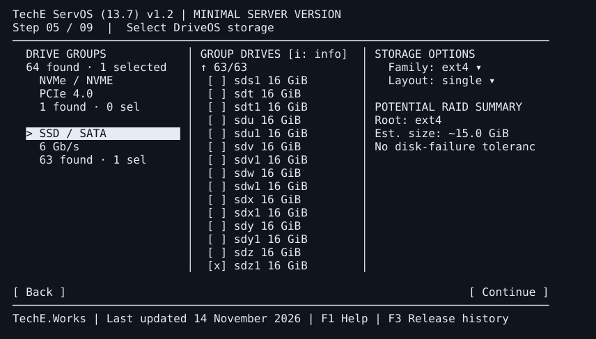
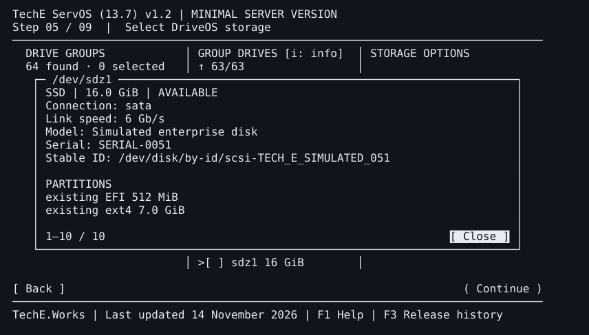
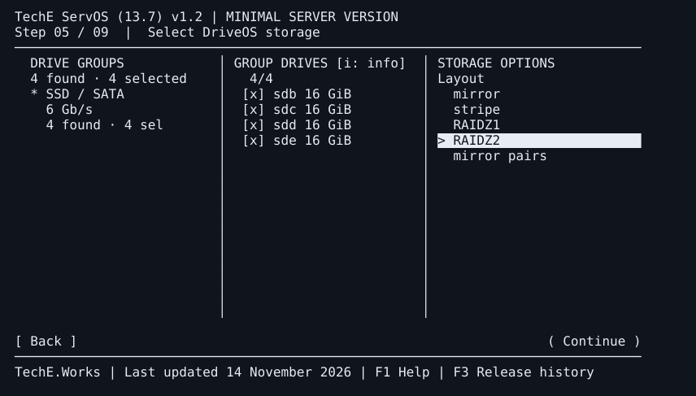
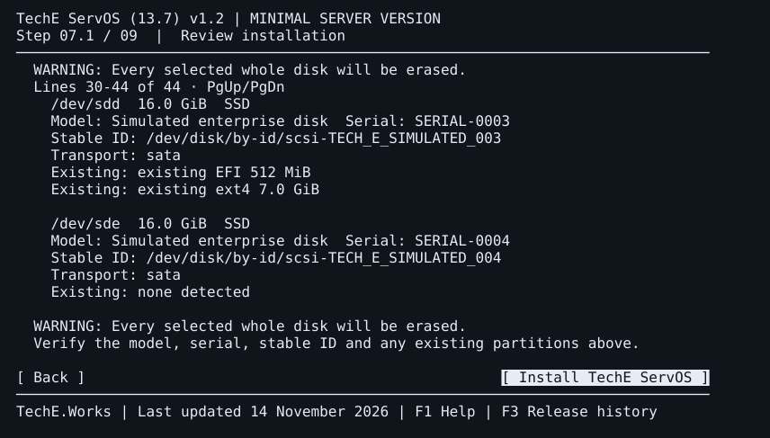
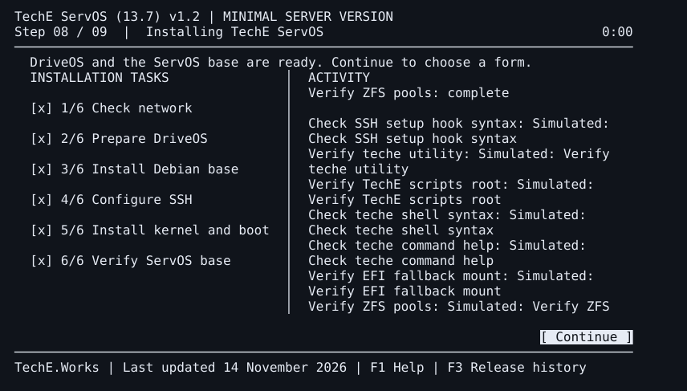
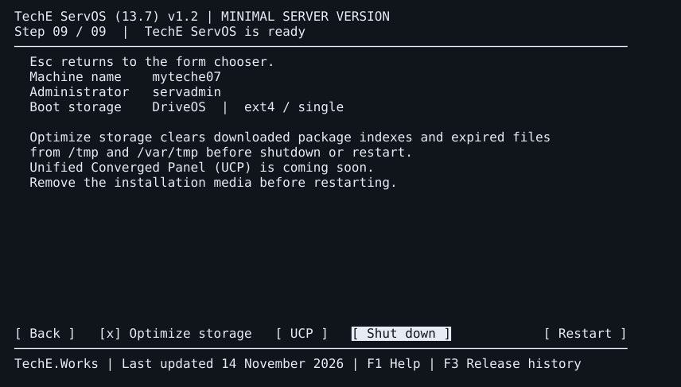

# ServOS installer gallery

These images render terminal frames saved in the v1.2 source simulation. The final standalone ISO opens the ServOS finish screen directly. The earlier finish frame shown here still displays Back.

[Live QEMU captures from the v1.1 release candidate](../../1.1.0/screenshots/README.md) are available separately.

## Preparation and live SSH

## 64-drive inventory and scrolling

## Drive details popup

## ZFS layout dropdown

## RAIDZ2 review and disk confirmation

## Installation task and activity view

## Standalone storage cleanup option in the source audit

