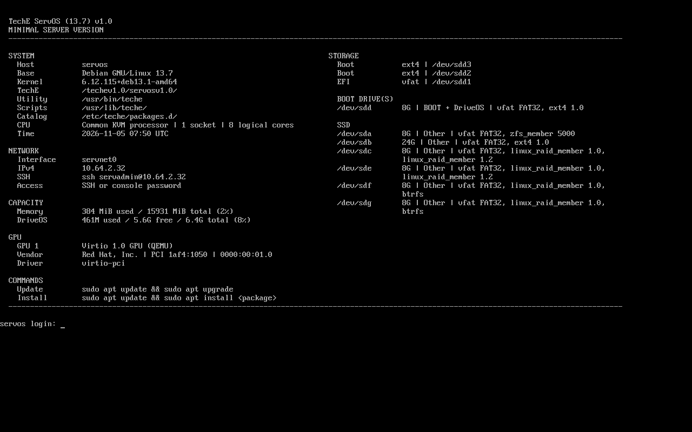
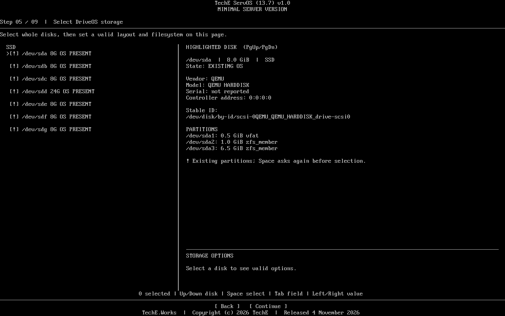
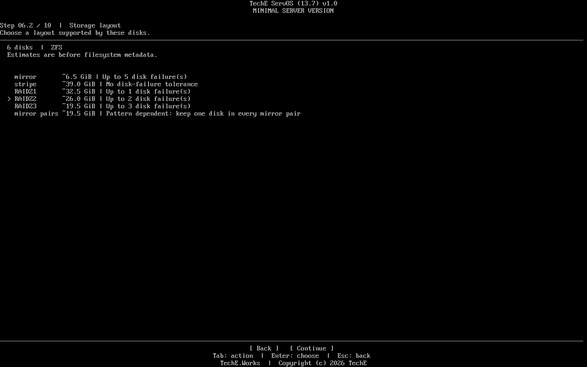

# TechE ServOS (13.7) v1.0

**Release identity:** The download links below belong to historical public
`servosv1.0-v1.0.0` only. A new S4 scripts-only candidate has a
[public QA screen preview](https://techeworks.github.io/release/servosv1.0/candidate-582e026/)
with its exact ISO hash and test limits. That candidate is **not approved for
production download**; its public ISO, scripts fetch, full QA and release
decision remain pending. The historical ISO and its QA do not transfer to it.

**A minimal Debian foundation for remotely provisioning the next system.**

Built on **Debian GNU/Linux 13.7**, ServOS turns a blank physical server or VM
into a bootable, networked base with OpenSSH, sudo and APT. From there, an
administrator can connect over SSH and install the role that machine actually
needs: a Docker Engine host, WorkDesk, a hypervisor base, or a GPU and LLM
workload. ServOS installs none of those larger roles by default.

The network installer is about **68.4 MiB**. It is designed for administrators
bringing provider hardware, rack servers and VMs online from a consistent
starting point, while downloading the packages needed for the selected
storage layout.

**DriveOS** is the name of the boot disk or disk set; **TechE ServOS** is the
system installed on it.

## Start here

- **Deploy a server:** [download the installer ISO](https://github.com/TechEWorks/release/releases/download/servosv1.0-v1.0.0/TechE-ServOS-13.7-v1.0-amd64-network.iso),
  [verify its SHA-256](https://github.com/TechEWorks/release/releases/download/servosv1.0-v1.0.0/SHA256SUMS.txt)
  and follow the [install guide](1.0.0/INSTALL.md).
- **Build your own ISO:** download the [public source ZIP](https://github.com/TechEWorks/release/releases/download/servosv1.0-v1.0.0/TechE-ServOS-13.7-v1.0-SOURCE.zip)
  and follow the [build guide](1.0.0/BUILD.md).
- **Evaluate the release:** read the [full feature path](1.0.0/FEATURES.md)
  and [exact-release QA record](1.0.0/QA.md).
- **Review the current Production evaluation:** start with the
  [public evidence status](1.0.0/production-evaluation-20261113/PUBLIC-STATUS.md),
  then inspect the [front page, capability gallery and detailed records](1.0.0/production-evaluation-20261113/README.md).
  This evidence update adds no new ISO asset or approval decision.

## S4 release map — request, output and proof

| Administrator need | Delivered in public 1.0.0 | Exact evidence and limit |
| --- | --- | --- |
| Install a minimal Debian 13.7 base | [Deployable network ISO](https://github.com/TechEWorks/release/releases/download/servosv1.0-v1.0.0/TechE-ServOS-13.7-v1.0-amd64-network.iso), 71,696,384 bytes, SHA-256 `b449436c0575a0dd95d61a3a228b0cbe465f415b64dea392352b1da2c04556cf` | [Manifest](1.0.0/RELEASE-MANIFEST.json), [checksums](1.0.0/SHA256SUMS.txt), [exact-ISO QA](1.0.0/QA.md) |
| Choose boot storage and protect the erase target | [Feature contract](1.0.0/FEATURES.md) and [install guide](1.0.0/INSTALL.md) | [Published ISO tests](1.0.0/QA.md) name the layouts, disks, cold boots and recovery actually observed; other cases stay open |
| Administer the installed base remotely | OpenSSH, sudo and APT after installation | [Exact-ISO SSH, APT, static IPv4 and key-path evidence](1.0.0/QA.md); coverage is limited to recorded VM225 paths |
| Rebuild and inspect source | [Source ZIP](https://github.com/TechEWorks/release/releases/download/servosv1.0-v1.0.0/TechE-ServOS-13.7-v1.0-SOURCE.zip), [build guide](1.0.0/BUILD.md) and [legal record](1.0.0/LEGAL.md) | [Byte-identical public rebuild](1.0.0/QA.md#verified-checks); upstream notice inventory and release signature remain open |

The [seven S4 stage catalogs](#s4-stage-catalogs) identify which stage has a public asset. [04-base-release](04-base-release/README.md) points to the existing stable 1.0.0 file and its **own** QA. The private beta.1 ISO has a different SHA-256; no Beta test result is carried into this public release. A future production-qualified candidate must rerun every required case on its own exact ISO. Public 1.0.0 predates S4 adoption and has no retroactive frozen S4 packet.


## One small base, many possible systems

| Build next | Start with ServOS, then add |
| --- | --- |
| Container host | Docker Engine and the services that host will run |
| WorkDesk system | The WorkDesk desktop and application layer |
| Hypervisor base | The chosen virtualization stack and its management layer |
| GPU or LLM node | Hardware drivers, model runtime and workloads suited to that GPU |
| Custom server | Only the packages, network access and services that role requires |

## Choose the DriveOS layout

The installer can inspect and select **up to 64 whole drives**. Select the
drives you have; ServOS shows the layouts eligible for that count. RAID1 is
one choice among several, and mixed drive sizes are allowed with a capacity
warning. A USB target can be used only as a single drive.

| Selected drives | Layouts offered by the installer |
| --- | --- |
| 1 | ext4, XFS, Btrfs or ZFS |
| 2–64, ZFS | Mirror or stripe; RAIDZ1 from 3, RAIDZ2 from 4, RAIDZ3 from 5, and mirror pairs with an even count of at least 4 |
| 2–64, mdadm | RAID0, RAID1 or RAID10; RAID5 from 3 and RAID6 from 4; ext4 or XFS over the array |
| 2–64, Btrfs | Single, RAID0 or RAID1; RAID1C3 from 3 and RAID10 or RAID1C4 from 4 |

Here are practical starting points, not limits on what the menu permits:

| Drives selected | A real-world starting point | Example layout |
| --- | --- | --- |
| 1 | A small monitoring or utility server where simple storage matters most | ext4 or XFS; no disk redundancy |
| 2 | A remote Docker Engine or WorkDesk base that should tolerate one disk failure | ZFS mirror, mdadm RAID1 with ext4/XFS, or Btrfs RAID1 |
| 3 | A capacity-focused application host | ZFS RAIDZ1 or mdadm RAID5; tolerates one drive failure |
| 4 | A VM or database host with frequent random I/O | ZFS mirror pairs, mdadm RAID10, or Btrfs RAID10 |
| 6 | A storage-heavy application or backup repository | ZFS RAIDZ2 or mdadm RAID6; tolerates two drive failures |
| 8 | A larger archival or model repository | ZFS RAIDZ3; tolerates three drive failures |

The installer filters layouts by drive count and displays estimated capacity
and failure tolerance; the operator chooses the result that fits the workload.
Mixed capacities are selectable, but the installer warns when sizes differ.
RAID does not replace backups. The [QA record](1.0.0/QA.md) distinguishes
these available choices from layouts cold-booted on the published ISO.

Storage behavior behind the examples is described by
[OpenZFS](https://openzfs.github.io/openzfs-docs/Basic%20Concepts/Pool%20Structure/VDEVs.html),
[Btrfs](https://btrfs.readthedocs.io/en/stable/mkfs.btrfs.html) and the
[mdadm manual](https://man7.org/linux/man-pages/man8/mdadm.8.html).

Once booted, the machine is reachable by SSH on a connected network. Use the
administrator shell, APT or a later role installer to provision the next
system remotely. Interactive SSH displays the same system summary as the
console and offers a text setup menu; ordinary noninteractive SSH commands
remain available for automation.

## Why this exists

Remote provisioning needs a predictable first layer: a bootable OS on the
intended storage, working IPv4, an administrator account and SSH. Preparing that
layer by hand on different servers consumes time before the actual application
installation can even begin. ServOS prepares it in one guided text workflow
with disk inspection, layout selection, erase review and live progress.
Debian Installer already supports mdadm and an optional SSH network console;
ServOS brings the broader ZFS, multi-disk Btrfs and mdadm choices together as
the foundation for the next installation.

This matters when a machine is in a rack, at a provider or inside a VM:
prepare it through its console, then use SSH for the next setup steps. Install
NetBird or another VPN client afterward if the server needs private remote
reachability. The initial ISO setup still needs a local or remote-management
console; it does not bundle a VPN account, key or client.

## From blank machine to remote provisioning

1. **Connect.** Use DHCP by default or enter static IPv4, gateway and DNS.
   The network installer checks the package mirror.
2. **Inspect and choose.** Review disk size, model, serial, stable ID and
   existing partitions. The selected disk count determines which layouts
   appear, with estimated capacity and failure tolerance.
3. **Confirm and install.** Type `ERASE` to confirm the selected whole disks.
   Follow numbered tasks and a live installation log.
4. **Boot and extend.** Boot TechE ServOS from DriveOS. Sign in on the console
   or through SSH and install only the packages needed for this machine.

## The SSH handoff

The published ISO's first-boot console displays the installed Debian base,
kernel, network address, SSH command, boot storage, capacity and hardware.
An interactive SSH login uses the same system display, then offers the
administrator a remote setup menu or an ordinary shell.



The interactive SSH choice follows the system display:

```text
Press Enter to open setup, type shell for a shell, or exit to disconnect:

Remote setup

  1  Open administrator shell
  2  Set up WorkDesk
  3  Show system and network details
  4  Disconnect
```

The WorkDesk action requires a separately published, pinned WorkDesk package.
For other roles, open the shell or use noninteractive SSH commands to run
your own provisioning scripts.

## See the decisions before erasure

The disk view shows identity and existing partitions before selection. Mounted
or active disks are blocked. An unmounted disk with an existing OS is marked
and needs an extra selection step before the final erase confirmation.



Available layouts follow the number of selected disks. This six-disk example
shows ZFS choices with estimated usable capacity and failure tolerance.



These captures are from preceding installer candidates. The
[published ISO QA record](1.0.0/QA.md) identifies exact-release tests and open
checks; [all three captures](1.0.0/README.md#installer-captures) are in the
version record.

## Download, verify or build

The **1.0.0** release includes a 71,696,384-byte network installer ISO, its
source ZIP, pinned base ISO, manifest and SHA-256 checksums. An
[independent public rebuild](https://github.com/TechEWorks/release/actions/runs/41983978934)
produced a byte-identical ISO from the published build inputs. **The following
are tested examples, not the limit of the layout menu:** the exact release
ISO has live VM installation and cold-boot evidence for single-disk ext4, XFS
and ZFS; ZFS mirror; mdadm RAID1 with XFS; and Btrfs RAID1. The QA record
states the other storage, recovery and hardware paths still open.

| Start with | Link |
| --- | --- |
| Installer ISO, source and checksums | [ServOS 1.0.0 release](https://github.com/TechEWorks/release/releases/tag/servosv1.0-v1.0.0) |
| Installation and first boot | [Install guide](1.0.0/INSTALL.md) |
| Full storage, network and access path | [Feature guide](1.0.0/FEATURES.md) |
| Public-source rebuild | [Build guide](1.0.0/BUILD.md) |
| Exact tests and open checks | [QA record](1.0.0/QA.md) |
| License and upstream notices | [Legal notices](1.0.0/LEGAL.md) |

**Requirements:** x86-64 UEFI, Secure Boot off, wired IPv4 and Internet access
to a Debian package mirror. Verify the release checksum before deployment.
The [version record](1.0.0/README.md) and [release index](index.json) identify
the artifacts. Contact [sysadmin@teche.works](mailto:sysadmin@teche.works).

## S4 stage catalogs

| Stage | Public catalog status |
| --- | --- |
| [00 Explore/POC](00-explore-poc/README.md) | EMPTY — no approved public stage asset recorded |
| [01 Strawman](01-strawman/README.md) | EMPTY — no approved public stage asset recorded |
| [02 Alpha](02-alpha/README.md) | EMPTY — no approved public stage asset recorded |
| [03 Beta](03-beta/README.md) | EMPTY — private beta.1 is historical and not a public download |
| [04 Base release](04-base-release/README.md) | AVAILABLE — public 1.0.0 ISO, source and release records |
| [05 Install/deploy](05-install-deploy/README.md) | EMPTY — no separate approved stage deliverable recorded |
| [06 Support](06-support/README.md) | EMPTY — no separate approved stage deliverable recorded |

These catalog entries describe publication only. They do not create source-stage records, transfer QA between ISO hashes, or certify untested production environments.
