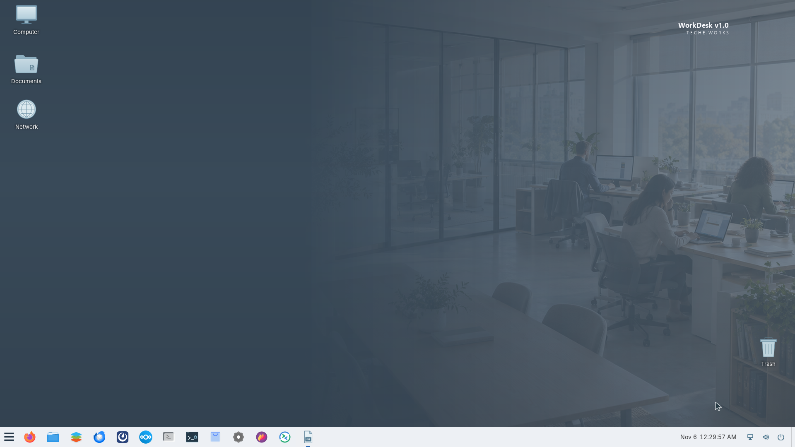
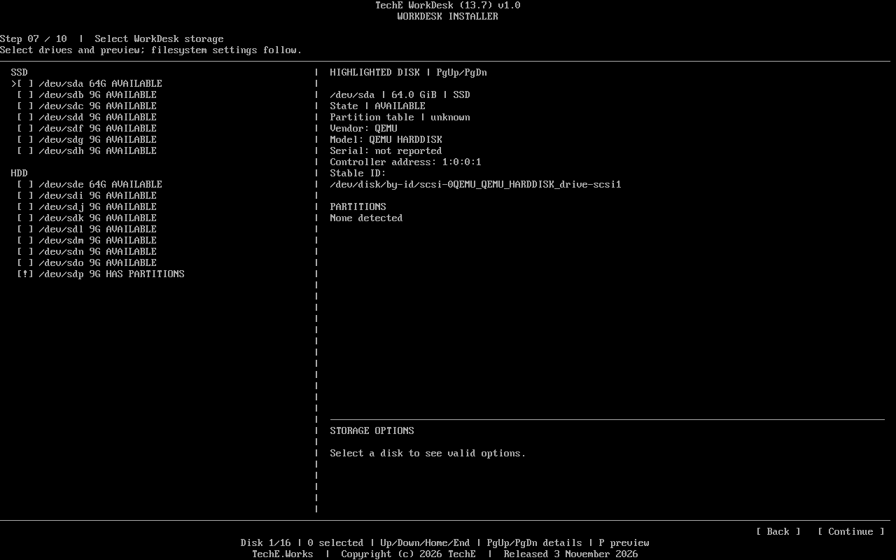
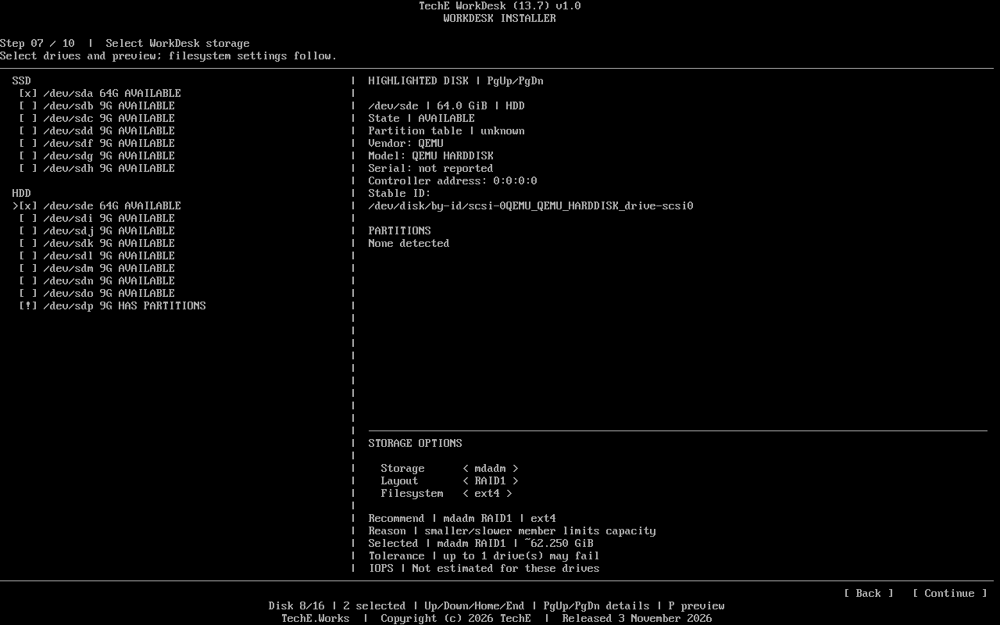
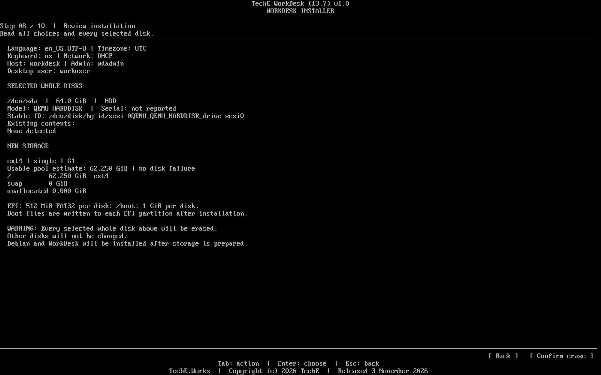
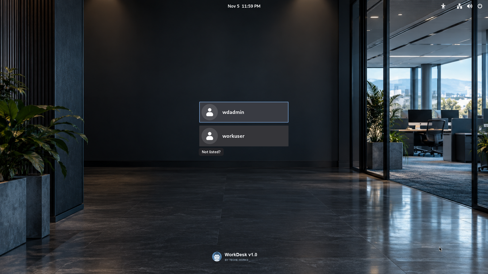

# TechE WorkDesk v1.0

**From disk choice to a ready-to-recognize work environment.** WorkDesk combines a guided Debian installation, storage planning, separate daily and maintenance accounts, and a branded business desktop. It is intended for both local and remotely accessed workstations. The available WD(txt) ISO is a **QA preview**, not an approved production release.

## Stage-specific downloads and testers

The seven S4 stages each have their own users, testers, asset selections and QA. Stage catalogs are [00 PoC](00-explore-poc/README.md), [01 Strawman](01-strawman/README.md), [02 Alpha](02-alpha/README.md), [03 Beta](03-beta/README.md), [04 Base Release](04-base-release/README.md), [05 Install/Deploy](05-install-deploy/README.md) and [06 Support](06-support/README.md). The [Alpha catalog](02-alpha/index.json) indexes previously published QA assets and installer dependencies; other stage catalogs currently record no approved public assets. A stage catalog is not the [approved product-release index](index.json), which remains empty.

Only cleared public preview assets are downloadable without repository access; internal source, unapproved binaries and restricted test evidence are private. Each stage verifies exact producer SHA-256 and executes its own QA, even when reusing another stage's asset. Newly published files require a single lossless ZIP, with native and ZIP each strictly below 2,000,000,000 decimal bytes. Existing public native QA assets are marked as legacy previews rather than falsely treated as compliant new ZIP publications.

## Why WorkDesk

| Design choice | Practical value | Current evidence and limit |
| --- | --- | --- |
| **Small network installer** | A 71.4 MiB boot ISO downloads pinned WorkDesk content and Debian packages during setup. | Exact size and checksum are [published below](#download-the-qa-preview). The installed system has no measured low-resource claim, and the observed install stage exceeded 12 minutes. |
| **Storage and desktop in one flow** | Inspect drive identity and existing partitions; select a compatible layout; see usable-capacity and failure-tolerance estimates; review what will be erased. | Single-disk ext4 and ZFS installed and booted in QA23. A two-disk ZFS mirror has a known degraded-boot EFI mount fault. Other layouts still need testing. |
| **Prepared business desktop** | TechE branding and launchers for Files, Firefox, ONLYOFFICE, Thunderbird, Mattermost, Nextcloud, terminal, Software and Settings are present on first sign-in. | Desktop and configured launchers were inspected. Complete application workflows remain open. |
| **Separate account roles** | Setup creates a daily user and a maintenance administrator. User home directories are private by default. | Roles and `0700` homes were verified on an installed QA VM. |
| **Repeatable user experience** | New users inherit WorkDesk wallpaper, theme and panel defaults. | Defaults and private homes were inspected; fresh-user GUI sessions remain open. |
| **Local and hosted direction** | The same WorkDesk product is designed for local machines and remote desktops. | XRDP is present; simultaneous multiuser RDP, reconnect and session isolation are not yet qualified. |

This is a proposed **combination of capabilities**, not a measured “2× better” result. [Zorin OS](https://zorin.com/os/), [Linux Mint](https://linuxmint.com/) and [Pop!_OS](https://system76.com/pop/) already offer polished desktops and productivity features. WorkDesk’s specific focus is bringing storage choice, account separation and a prepared business desktop through one installer. Any speed, usability or cost advantage needs a matched benchmark.

## Product direction

TechE plans optional AI/LLM tools, client-selectable packs, remote multiuser operation and graphical installer editions. **QA23 does not demonstrate a working AI backend, GPU pack, enterprise security clearance or production-ready RDP.** They are roadmap items, not current release claims.

| Installer edition | Availability | Delivery |
| --- | --- | --- |
| **WD(txt) network** | [QA preview 23 available](https://github.com/TechEWorks/release/releases/tag/workdeskv1.0-v1.0.0-qa.23) | Text setup; downloads pinned WorkDesk content and Debian packages. |
| **WD(gui) network** | Coming soon | Graphical setup with network delivery. |
| **WD(gui) offline** | Coming soon | Graphical setup with required content on the media. |

## Actual QA23 journey

These are unaltered captures from disposable QA virtual machines. The multi-disk screens prove the interface was exercised; they do **not** prove every advertised layout installs successfully.

1. **Inspect disks.** The inventory shows drive state, identity and partition information, with scrolling for many detected disks.

   

2. **Compare a layout.** The two-disk capture shows a proposed mdadm RAID1/ext4 layout, capacity estimate and one-disk failure tolerance. This path is not an installed QA23 pass.

   

3. **Review the erase target.** The successful single-disk ext4 path displayed the exact disk, layout and warning before confirmation.

   

4. **Sign in to WorkDesk.** The installed VM booted from disk to branded GDM; an ordinary user reached the configured desktop shown above.

   

The captures show what appeared in those runs. Open [functional and security checks](previews/qa23/README.md) remain open.

## Download the QA preview

**Use only in an isolated, disposable UEFI virtual machine. Installation erases selected disks.** Read the [preview record and known issues](previews/qa23/README.md) before booting.

| Asset | Bytes | SHA-256 |
| --- | ---: | --- |
| [WD(txt) network QA23 ISO](https://github.com/TechEWorks/release/releases/download/workdeskv1.0-v1.0.0-qa.23/TechE-WDtxt-Network-v1.0-d358c44-QA23.iso) | 74,842,112 | `33e876edc0a2397f64c02ef176e4be7b7248827d3dfb3c6096493c6c1d181738` |
| [ISO checksum file](https://github.com/TechEWorks/release/releases/download/workdeskv1.0-v1.0.0-qa.23/SHA256SUMS-ISO.txt) | 108 | See attached file |

1. Verify the ISO against the published SHA-256 or [preview manifest](previews/qa23/RELEASE-MANIFEST.json).
2. Attach it to a disposable UEFI VM with a blank disk and working internet. The observed QA profile used four logical CPUs, 8 GiB RAM and a 64 GiB disk. **This is a tested profile, not a published minimum requirement.**
3. Inspect the selected disk and erase warning. Detach the ISO before booting the installed disk.

## Release and licence status

The [approved release index](index.json) remains empty. QA23 has open gates including mirror-member EFI mounting, install duration, network exposure, exact component notices and wallpaper rights. Only the ISO and checksum are attached to the prerelease; its source and build-input archives are **not** attached there. Do not treat the preview as an independently rebuildable or enterprise-approved release.

TechE-authored WorkDesk code follows the same **AGPL-3.0-only** policy as [ServOS](https://github.com/TechEWorks/release/blob/main/servosv1.0/1.0.0/LEGAL.md), under the [TechE OS software policy](https://github.com/TechEWorks/release/blob/main/license/README.md). The exact QA23 corresponding-source offer and third-party notice package still need publication and verification. AGPL does **not** relicense Debian, GNOME, bundled applications, fonts or other third-party components. TechE names and logos are governed separately by the [IP policy](https://github.com/TechEWorks/release/blob/main/ip/README.md).
